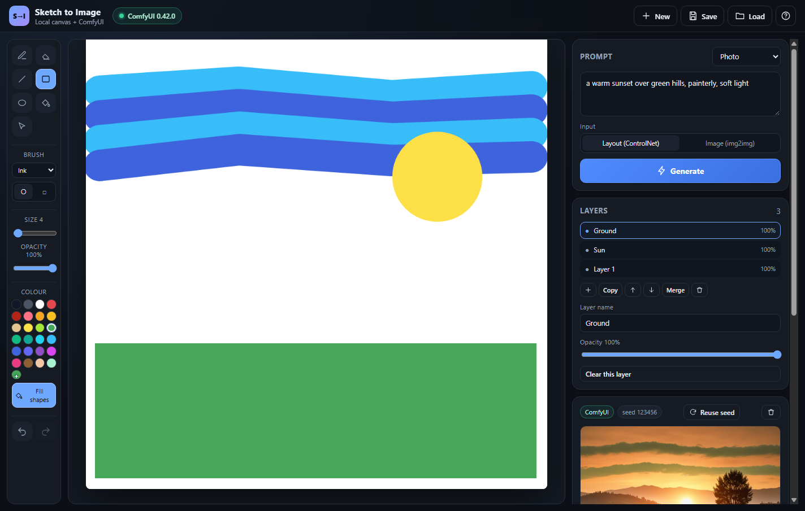

# Sketch to Image

Draw a rough layout on a canvas, write a short prompt, press **Generate**, and get an image
from your local ComfyUI. It is a small, single-user replacement for Krea's sketch-to-image
canvas — without the live streaming, with a button instead.



## What it does

- **A raster paint canvas**: brush (pressure-sensitive with a stylus), eraser, line, rectangle,
  circle, bucket fill, four brush presets with round or square tips, 24 colours plus a system
  colour picker, and 10-step pixel undo. Strokes are pixels, so they blend, overlap and erase
  the way you expect.
- **Layers**: add, duplicate, delete, reorder, rename, opacity, visibility, merge down, clear.
  Generation uses everything visible by default; switch **Layers used for generation** to
  *Selected layers only* to send just the layers you Ctrl/Shift-clicked.
- **Select and transform pixels**: drag a marquee and the handles appear immediately. Drag to
  move, corners to resize (Shift keeps proportions), the ring just outside a corner or the handle
  above to rotate freely, and a small bar to flip H/V, rotate 90°, apply (Enter) or cancel (Esc).
  While a selection exists, every tool paints inside it only; **Deselect** or Escape releases it.
- **Draw past the edge**: a stroke keeps following the pointer when it leaves the canvas and
  carries on when it comes back — same for shapes and for resizing to the edge.
- **Generated images become layers**: drag one onto the canvas (or press *To canvas*). It is
  scaled to fill the canvas from (0,0), so a 1024² generation lands exactly 1:1. A **cut the flat
  background** option makes the white transparent first, so the result sits over the layers below
  instead of covering them with a white square.
- **Two ways to generate**: *Layout (ControlNet)* uses the flattened painting as the composition;
  *Image (img2img)* repaints the canvas itself with a denoise slider.
- **ComfyUI pipeline**: SDXL + ControlNet Scribble + an optional Lightning LoRA for 8-step
  generation. Canvas goes up, image comes back in ~5 seconds at 1024 px on a warm RTX 5070 Ti.
- **Seed lock**, style presets, session gallery, project save/load (with layers), image download.
- **Delete a generation** from the result panel or with the × on a thumbnail, with a short undo.
- Works without ComfyUI: it falls back to a clearly-labelled local **demo render**, so you can
  try the canvas and the prompt builder before installing anything.

## Requirements

- Node.js 20 or newer.
- ComfyUI running on `http://127.0.0.1:8188` (see [docs/COMFYUI.md](docs/COMFYUI.md)).
- An SDXL checkpoint, an SDXL **scribble** ControlNet, and (optional) an SDXL-Lightning 8-step
  LoRA.
- A GPU with ~8 GB VRAM is enough for 1024×1024 SDXL.

## Quick start

```bash
npm install
npm run dev
```

Open <http://localhost:5173>. The app proxies `/comfy/*` to ComfyUI, so ComfyUI needs no CORS
configuration and the browser only talks to one origin.

If ComfyUI is not running, the badge in the top bar says **ComfyUI offline** and generation
produces a demo render.

## Using it

1. Pick a layer in the Layers panel (or add one) and a tool on the left.
2. Block in the composition with big strokes and fills. Layers keep parts separate.
3. Type a short prompt: subject, mood, style; pick a style preset.
4. Choose the input: **Layout (ControlNet)** keeps your composition, **Image (img2img)** repaints
   the whole canvas — lower the denoise to stay close to what you painted.
5. Press **Generate**.
6. Push it further: drag the result onto the canvas as a new layer, paint over the parts you
   dislike, hide or fade that layer, switch to Image mode, generate again.

Shortcuts: `B` brush, `E` eraser, `L` line, `R` rectangle, `O` circle, `G` bucket, `V` move,
`Ctrl+Z` undo, `Esc` deselect.

### Painting with a stylus

The brush reads `pointerType` and `pressure`, so a pen gives tapered strokes; a mouse draws at
constant width. Ink, Pencil, Marker and Airbrush differ in default size, opacity and softness,
and the Size / Opacity sliders override them per stroke. The **○ / □** buttons switch between
round and square end caps. The small **+** swatch at the end of the palette opens the system
colour picker for any colour you like.

## Settings worth knowing

| Setting | Why |
|---|---|
| Checkpoint / ControlNet / LoRA | Listed from ComfyUI itself; a stale name is replaced on the next connection check |
| Control strength (default 0.7) | Raise it when the image ignores your drawing |
| Stops at (default 0.8) | When the ControlNet lets go and the model adds detail |
| Quality: Fast / Quality | 8 steps with Lightning vs 25 steps without |
| Width | 768 is faster, 1024 is sharper |
| ComfyUI URL | `/comfy` (proxy) by default; an absolute URL needs `--enable-cors-header` |

## Scripts

| Command | What it does |
|---|---|
| `npm run dev` | Vite dev server with the ComfyUI proxy |
| `npm run build` | Typecheck and build into `dist/` |
| `npm run preview` | Serve `dist/` with the same proxy |
| `npm run typecheck` | `tsc --noEmit` |
| `npm test` | Unit tests (prompt builder, workflow wiring, geometry) |
| `npm run smoke` | Headless end-to-end check in Chrome (see below) |

The smoke test needs a dev server and a Chrome with remote debugging:

```bash
# terminal 1
npm run dev
# terminal 2
chrome --headless=new --remote-debugging-port=9222 --window-size=1440,1000 --user-data-dir=%TEMP%\wig-cdp about:blank
# terminal 3
npm run smoke
```

It draws two shapes, types a prompt, presses Generate, and checks the result image — useful
after changing the canvas or the generation flow.

## Project layout

```text
src/
  canvas/        Konva stage, pointer tools, shape rendering
  comfy/         ComfyUI client and workflow builder
  components/    Panels: toolbar, prompt, result, gallery, settings, help
  lib/           Scene → prompt, scene → sketch PNG, geometry, presets, demo renderer
  store/         Zustand store: shapes, history, settings, results
docs/            PLAN, FEATURES, ARCHITECTURE, COMFYUI setup
scripts/         smoke.mjs
```

## Limits (by design)

- One user, no accounts, no server beyond Vite.
- No live generation; you press a button.
- The gallery lives in memory for the session; projects save to a JSON file.
- Editing an existing image (inpainting) is planned but not built yet.

## Docs

- [docs/PLAN.md](docs/PLAN.md) — goal, constraints, milestones, decisions
- [docs/FEATURES.md](docs/FEATURES.md) — what works today
- [docs/ARCHITECTURE.md](docs/ARCHITECTURE.md) — data flow, modules, workflow node map
- [docs/COMFYUI.md](docs/COMFYUI.md) — installing ComfyUI, model files, troubleshooting
- [AGENTS.md](AGENTS.md) — instructions for coding agents working on this repo
